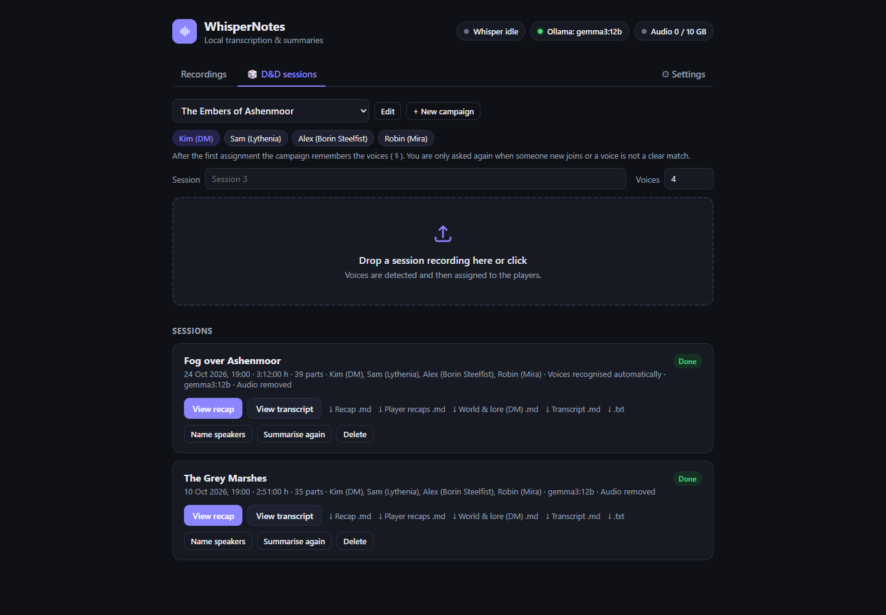
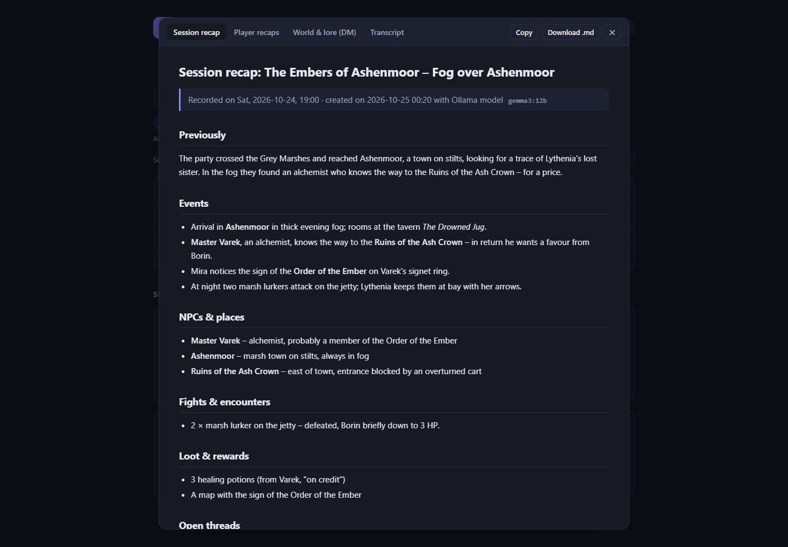
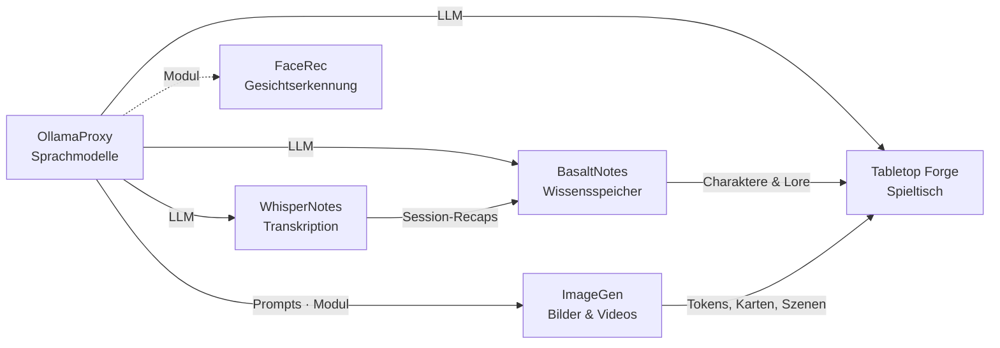

# WhisperNotes

🇬🇧 [English](README.md) · 🇩🇪 Deutsch

> Lokale Transkription mit whisper.cpp: OpenAI-kompatible API, Dashboard für lange Aufnahmen, Sprechererkennung,
> Zusammenfassungen und D&D-Session-Recaps – das Ohr der Poldion-Familie.

**Lizenz:** MIT · **Sprache:** Python (FastAPI), React, Node.js (Discord-Bot) ·
**Läuft auf:** Linux (Docker: AMD, NVIDIA oder nur CPU) und macOS (Apple Silicon) · **Docker:** `poldion/whispernotes` ·
**Teil von:** [Poldion Self-Hosted](#die-poldion-familie)



## Überblick

WhisperNotes legt eine schlanke API um [whisper.cpp](https://github.com/ggml-org/whisper.cpp). `whisper-server`
startet erst bei Bedarf und beendet sich nach zwei Minuten Leerlauf. So bleibt der Speicher für Sprachmodelle frei.
Kurze Clips (Home Assistant, Discord) gehen über die OpenAI-kompatible API. Lange Aufnahmen lädst du im Dashboard hoch.
Sie werden zerlegt, transkribiert, Sprechern zugeordnet und zusammengefasst.

## Funktionen

| Bereich | Was es kann |
|---|---|
| **OpenAI-kompatibel** | `POST /v1/audio/transcriptions` – für Home Assistant, Skripte und das `openai`-SDK, mit eigenem Whisper-Modell für Sprachbefehle |
| **On-Demand** | `whisper-server` startet beim ersten Request und stoppt nach Leerlauf, Anfragen werden eingereiht, Live-Anfragen haben Vorrang vor Batch-Jobs |
| **Dashboard** | Upload langer Aufnahmen → 5-Minuten-Stücke → Master-Transkript → Map-Reduce-Zusammenfassung, Fortschritt live |
| **Sprechererkennung** | sherpa-onnx (CPU, Standard) oder pyannote.audio (GPU), Namen per Hörprobe zuordnen, Stimmprofile je Kampagne |
| **D&D-Tab** | Kampagnen mit Runde und Glossar; Session-Recaps mit Handlung, NPCs & Orten, Kämpfen, Beute, offenen Fäden und Zitaten, dazu Recaps je Spielercharakter und Weltwissen für den DM |
| **Discord-Bot** | Nimmt Voice-Channels auf, jede Person als eigene Spur (auch mit Discords E2E-Verschlüsselung DAVE), postet die Zusammenfassung |
| **Sprachmodell** | Zusammenfassungen über Ollama bzw. den OllamaProxy – festes Modell oder das gerade geladene |
| **Sprachen** | Oberfläche und Zusammenfassungen auf Deutsch oder Englisch |
| **Vorlagen** | Abschnitte, Länge und Ton der Dokumente im Dashboard anpassbar |
| **Zugang** | Offen fürs Heimnetz oder mit API-Schlüssel und Dashboard-Passwort |
| **Logbuch** | Optionale Metadaten-Header (`X-Speaker-Name`, `X-Session-Id` …) und Nachbearbeitung per LLM |



## Schnellstart

**Linux mit Docker** (Details, NVIDIA und CPU: [docs/docker.md](docs/docker.md)):

```bash
git clone https://github.com/Poldion/WhisperNotes.git && cd WhisperNotes
cp docker/.env.example docker/.env && cp docker/whispernotes.env.example docker/whispernotes.env   # anpassen
mkdir -p docker/data
docker compose -f docker/compose.yml up -d --build                                  # AMD-GPU
docker compose -f docker/compose.yml -f docker/compose.nvidia.yml up -d --build     # NVIDIA-GPU
docker compose -f docker/compose.yml -f docker/compose.cpu.yml up -d --build        # nur CPU
# zusätzlich Ollama und Discord-Bot: --profile ollama --profile discord
```

**macOS (Apple Silicon):**

```bash
git clone https://github.com/Poldion/WhisperNotes.git ~/WhisperNotes && cd ~/WhisperNotes
bash deploy/setup_mac.sh
```

Das Skript baut `whisper-server` mit Metal, lädt die Modelle, führt die Tests aus und richtet den Dienst ein.
Danach das Dashboard unter `http://<host>:8000/dashboard/` öffnen. Für Home Assistant eine OpenAI-kompatible
STT-Integration (z. B. per HACS) mit der URL `http://<host>:8000/v1` und dem Modell `whisper-1` einrichten.
Läuft WhisperNotes außerhalb des Heimnetzes, unter **Einstellungen → Zugang** einen API-Schlüssel setzen.

## Konfiguration

| Variable | Standard | Bedeutung |
|---|---|---|
| `LANGUAGE` / `WHISPER_LANGUAGE` | `de` / `de` | Sprache der Oberfläche und Zusammenfassungen / der Aufnahmen |
| `API_KEY` / `DASHBOARD_PASSWORD` | – | Zugangsschutz (leer = offen, fürs Heimnetz) |
| `OLLAMA_URL` | `http://localhost:11434` | Ollama bzw. OllamaProxy für Zusammenfassungen |
| `IDLE_TIMEOUT` | `120` | Sekunden Leerlauf, bis `whisper-server` beendet wird |
| `INFERENCE_TIMEOUT` | `180` | Höchstdauer je Request oder Stück |
| `CHUNK_SECONDS` / `CHUNK_OVERLAP_SECONDS` | `300` / `10` | Zerlegung langer Dateien |
| `DIARIZATION_ENGINE` | `sherpa` | `sherpa` oder `pyannote` (braucht `HF_TOKEN`) |
| `BASALT_URL` / `BASALT_TOKEN` | – | Recaps an BasaltNotes schicken (leer = aus) |
| `PUBLIC_URL` | – | Eigene Adresse für Links aus BasaltNotes und Discord |

Vollständige Liste: [backend/.env.example](backend/.env.example) und [backend/app/config.py](backend/app/config.py).
Fast alles lässt sich auch im Dashboard unter **Einstellungen** ändern.

## Zusammenspiel mit der Poldion-Familie

- **[OllamaProxy](https://github.com/Poldion/OllamaProxy)** liefert das Sprachmodell. WhisperNotes liest die
  erzwungene Kontextgröße und teilt lange Transkripte passend auf.
- **[BasaltNotes](https://github.com/Poldion/BasaltNotes)** bekommt fertige Session-Recaps in den Eingang. Der
  KI-Kurator legt daraus NPCs, Orte und Quests an. Umgekehrt liefert BasaltNotes das Glossar (Namen der Welt), damit
  Whisper sie richtig schreibt.
- Über BasaltNotes erscheinen die Recaps auch in **[Tabletop Forge](https://github.com/Poldion/TabletopForge)**.

## Die Poldion-Familie

Sechs selbst gehostete Projekte, die einzeln funktionieren und zusammen ein Ganzes ergeben:



| Projekt | Rolle |
|---|---|
| [OllamaProxy](https://github.com/Poldion/OllamaProxy) | KI-Zentrale: Sprachmodelle mit festen Einstellungen, Module für weitere Dienste |
| [ImageGen](https://github.com/Poldion/ImageGen) | Bilder und Videos mit ComfyUI, Web-App und API |
| [FaceRec](https://github.com/Poldion/FaceRec) | Gesichtserkennung an der Türklingel für Home Assistant |
| **WhisperNotes** (dieses Repository) | Transkription, Sprechererkennung, Zusammenfassungen und D&D-Recaps |
| [BasaltNotes](https://github.com/Poldion/BasaltNotes) | Notizen und Welt-Wiki mit KI-Kurator |
| [Tabletop Forge](https://github.com/Poldion/TabletopForge) | Digitaler Spieltisch und Kampagnenverwaltung für 5e |

## Dokumentation

- [docs/handbuch.md](docs/handbuch.md) – API, Discord-Bot, Header, Zugang, Sprache, alle Einstellungen (Englisch: [manual.md](docs/manual.md))
- [docs/docker.md](docs/docker.md) – Betrieb mit Docker unter Linux (AMD, NVIDIA oder nur CPU) (Englisch: [docker.en.md](docs/docker.en.md))
- [docs/spezifikation.md](docs/spezifikation.md) – ursprüngliche Spezifikation
- [CHANGELOG.md](CHANGELOG.md) – Versionsverlauf (nur Englisch)
- [CONTRIBUTING.md](CONTRIBUTING.md) – Entwicklungsumgebung, Tests, Regeln (nur Englisch, mit deutschem Abschnitt)
- [SECURITY.md](SECURITY.md) – Sicherheitslücken melden (nur Englisch)

## Entwicklung

Ohne Apple-GPU ersetzt `backend/tools/mock_whisper_server.py` den `whisper-server`.

```bash
cd backend && uv sync && uv run pytest -q
cd frontend && npm install && npm run dev          # http://localhost:5173/dashboard/
cd discord-bot && npm install && npm test
```

Mehr dazu, auch zu Übersetzungen: [CONTRIBUTING.md](CONTRIBUTING.md). Die CI führt alle Tests bei jedem Push aus.

## Lizenz & Drittanbieter

Der Code steht unter der [MIT-Lizenz](LICENSE). Modelle werden nicht mitgeliefert, sondern bei der Einrichtung aus
ihren offiziellen Quellen geladen und haben eigene Lizenzen. Das optionale Segmentierungsmodell reverb-diarization-v1
ist **nur für nicht-kommerzielle Nutzung** freigegeben, der Standard (pyannote segmentation-3.0) steht unter MIT.
Alles Weitere: [THIRD_PARTY_NOTICES.md](THIRD_PARTY_NOTICES.md). Dungeons & Dragons ist eine Marke von Wizards of the
Coast. WhisperNotes ist damit nicht verbunden.

**Aufnahmen:** Nimm Gespräche nur mit dem Einverständnis aller Anwesenden auf. Der Discord-Bot kündigt jede Aufnahme im
Channel an.

## Unterstützen

Wenn dir das Projekt hilft, freue ich mich über Rückmeldungen, Fehlerberichte und Pull Requests – siehe
[CONTRIBUTING.md](CONTRIBUTING.md).
Du kannst mir auch [einen Kaffee ausgeben](https://buymeacoffee.com/poldion).
