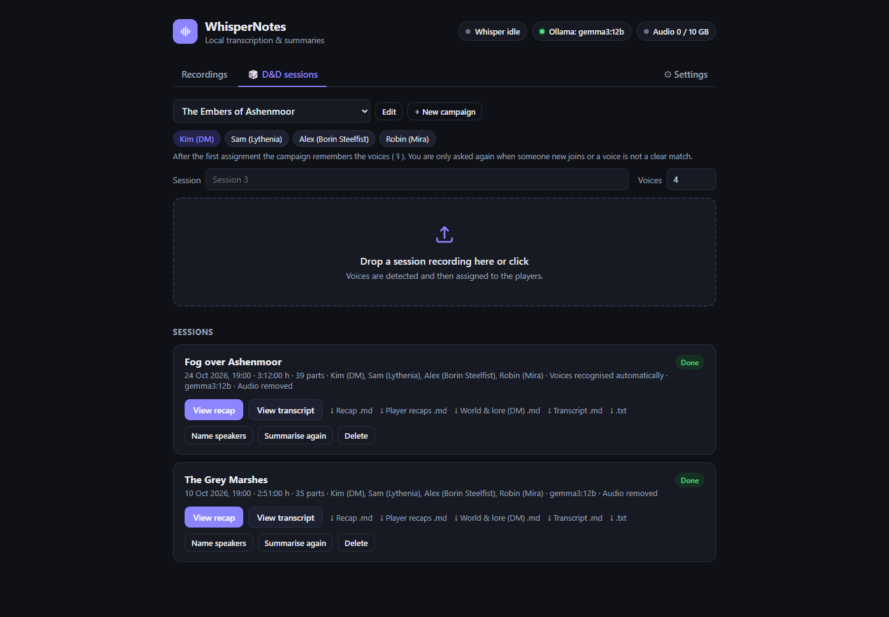
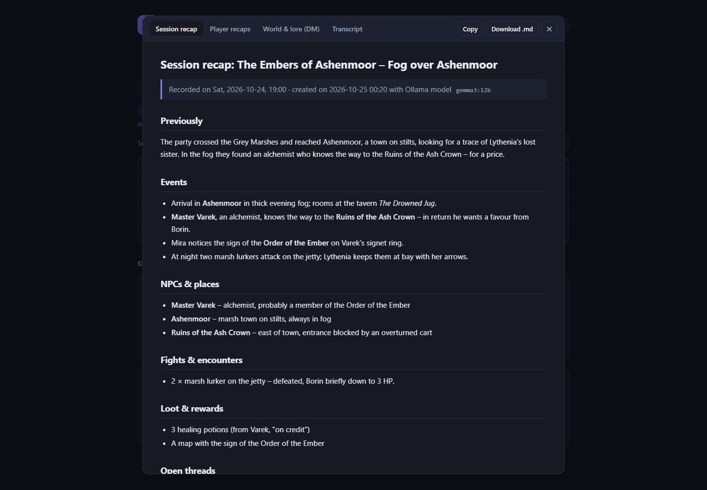
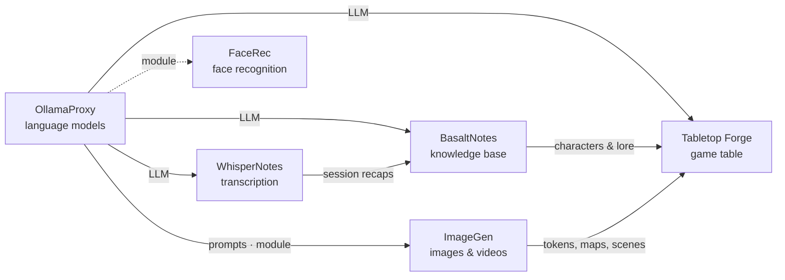

# WhisperNotes

🇬🇧 English · 🇩🇪 [Deutsch](README.de.md)

> Local transcription with whisper.cpp: an OpenAI-compatible API, a dashboard for long recordings, speaker detection,
> summaries and D&D session recaps – the ears of the Poldion family.

**License:** MIT · **Language:** Python (FastAPI), React, Node.js (Discord bot) ·
**Runs on:** Linux (Docker: AMD, NVIDIA or CPU only) and macOS (Apple Silicon) · **Docker:** `poldion/whispernotes` ·
**Part of:** [Poldion Self-Hosted](#the-poldion-family)



## Overview

WhisperNotes puts a lean API around [whisper.cpp](https://github.com/ggml-org/whisper.cpp). `whisper-server` only
starts when needed and stops after two minutes of idle time, which keeps memory free for language models. Short clips
(Home Assistant, Discord) go through the OpenAI-compatible API. Long recordings are uploaded in the dashboard, where
they are split, transcribed, assigned to speakers and summarised.

## Features

| Area | What it does |
|---|---|
| **OpenAI-compatible** | `POST /v1/audio/transcriptions` – for Home Assistant, scripts and the `openai` SDK, with its own Whisper model for voice commands |
| **On demand** | `whisper-server` starts with the first request and stops when idle; requests are queued, live requests take priority over batch jobs |
| **Dashboard** | Upload long recordings → 5-minute parts → master transcript → map-reduce summary, live progress |
| **Speaker detection** | sherpa-onnx (CPU, default) or pyannote.audio (GPU), assign names by listening to samples, voice profiles per campaign |
| **D&D tab** | Campaigns with party and glossary; session recaps with story, NPCs & places, fights, loot, open threads and quotes, plus a recap per player character and world lore for the DM |
| **Discord bot** | Records voice channels with one track per person (including Discord's E2E encryption DAVE) and posts the summary |
| **Language model** | Summaries through Ollama or OllamaProxy – a fixed model or the one currently loaded |
| **Languages** | Interface and summaries in English or German |
| **Templates** | Sections, length and tone of the documents can be adjusted in the dashboard |
| **Access** | Open for the home network, or protected with an API key and a dashboard password |
| **Log book** | Optional metadata headers (`X-Speaker-Name`, `X-Session-Id` …) and LLM post-processing |



## Quick start

**Linux with Docker** (details, NVIDIA and CPU: [docs/docker.md](docs/docker.md), German):

```bash
git clone https://github.com/Poldion/WhisperNotes.git && cd WhisperNotes
cp docker/.env.example docker/.env && cp docker/whispernotes.env.example docker/whispernotes.env   # adjust
mkdir -p docker/data
docker compose -f docker/compose.yml up -d --build                                  # AMD GPU
docker compose -f docker/compose.yml -f docker/compose.nvidia.yml up -d --build     # NVIDIA GPU
docker compose -f docker/compose.yml -f docker/compose.cpu.yml up -d --build        # CPU only
# add Ollama and the Discord bot: --profile ollama --profile discord
```

**macOS (Apple Silicon):**

```bash
git clone https://github.com/Poldion/WhisperNotes.git ~/WhisperNotes && cd ~/WhisperNotes
bash deploy/setup_mac.sh
```

The script builds `whisper-server` with Metal, downloads the models, runs the tests and sets up the service.
Then open the dashboard at `http://<host>:8000/dashboard/` and switch the language under **Settings → General**
(`LANGUAGE=en`). For Home Assistant, set up an OpenAI-compatible STT integration (e.g. via HACS) with the URL
`http://<host>:8000/v1` and the model `whisper-1`. If WhisperNotes runs outside your home network, set an API key
under **Settings → Access**.

## Configuration

| Variable | Default | Meaning |
|---|---|---|
| `LANGUAGE` / `WHISPER_LANGUAGE` | `de` / `de` | Language of the interface and summaries / of the recordings |
| `API_KEY` / `DASHBOARD_PASSWORD` | – | Access protection (empty = open, for the home network) |
| `OLLAMA_URL` | `http://localhost:11434` | Ollama or OllamaProxy for summaries |
| `IDLE_TIMEOUT` | `120` | Seconds of idle time before `whisper-server` is stopped |
| `INFERENCE_TIMEOUT` | `180` | Maximum duration per request or part |
| `CHUNK_SECONDS` / `CHUNK_OVERLAP_SECONDS` | `300` / `10` | Splitting of long files |
| `DIARIZATION_ENGINE` | `sherpa` | `sherpa` or `pyannote` (needs `HF_TOKEN`) |
| `BASALT_URL` / `BASALT_TOKEN` | – | Send recaps to BasaltNotes (empty = off) |
| `PUBLIC_URL` | – | Own address for links from BasaltNotes and Discord |

Full list: [backend/.env.example](backend/.env.example) and [backend/app/config.py](backend/app/config.py).
Almost everything can also be changed in the dashboard under **Settings**.

## Working with the Poldion family

- **[OllamaProxy](https://github.com/Poldion/OllamaProxy)** provides the language model. WhisperNotes reads the
  enforced context size and splits long transcripts to fit.
- **[BasaltNotes](https://github.com/Poldion/BasaltNotes)** receives finished session recaps in its inbox, and its AI
  curator turns them into NPCs, places and quests. In return, BasaltNotes provides the glossary (names of the world)
  so Whisper spells them correctly.
- Through BasaltNotes, the recaps also show up in **[Tabletop Forge](https://github.com/Poldion/TabletopForge)**.

## The Poldion family

Six self-hosted projects that work on their own and form a whole together:



| Project | Role |
|---|---|
| [OllamaProxy](https://github.com/Poldion/OllamaProxy) | AI hub: language models with fixed settings, modules for other services |
| [ImageGen](https://github.com/Poldion/ImageGen) | Images and videos with ComfyUI, web app and API |
| [FaceRec](https://github.com/Poldion/FaceRec) | Face recognition at the doorbell for Home Assistant |
| **WhisperNotes** (this repository) | Transcription, speaker detection, summaries and D&D recaps |
| [BasaltNotes](https://github.com/Poldion/BasaltNotes) | Notes and world wiki with an AI curator |
| [Tabletop Forge](https://github.com/Poldion/TabletopForge) | Digital game table and campaign management for 5e |

## Documentation

- [docs/handbuch.md](docs/handbuch.md) – API, Discord bot, headers, access, language, all settings (German)
- [docs/docker.md](docs/docker.md) – running with Docker on Linux: AMD, NVIDIA or CPU only (German)
- [docs/spezifikation.md](docs/spezifikation.md) – original specification (German)
- [CHANGELOG.md](CHANGELOG.md) – version history
- [CONTRIBUTING.md](CONTRIBUTING.md) – development setup, tests, guidelines, translations
- [SECURITY.md](SECURITY.md) – reporting security issues

## Development

Without an Apple GPU, `backend/tools/mock_whisper_server.py` stands in for `whisper-server`.

```bash
cd backend && uv sync && uv run pytest -q
cd frontend && npm install && npm run dev          # http://localhost:5173/dashboard/
cd discord-bot && npm install && npm test
```

More, including translations: [CONTRIBUTING.md](CONTRIBUTING.md). CI runs all tests on every push.

## License & third parties

The code is licensed under the [MIT License](LICENSE). Models are not bundled; they are downloaded from their official
sources during setup and come with their own licenses. The optional segmentation model reverb-diarization-v1 is
**licensed for non-commercial use only**; the default (pyannote segmentation-3.0) is MIT. Details:
[THIRD_PARTY_NOTICES.md](THIRD_PARTY_NOTICES.md). Dungeons & Dragons is a trademark of Wizards of the Coast;
WhisperNotes is not affiliated with it.

**Recordings:** Only record conversations with the consent of everyone present. The Discord bot announces every
recording in the channel.

## Support

If the project helps you, I'm happy about feedback, bug reports and pull requests – see [CONTRIBUTING.md](CONTRIBUTING.md).
A donation link will follow. <!-- SPENDEN_LINK -->
